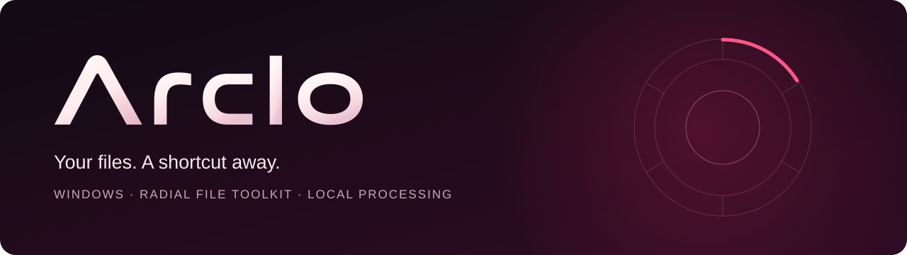
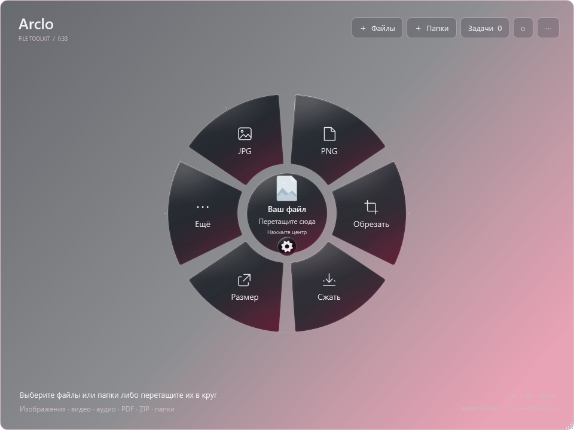
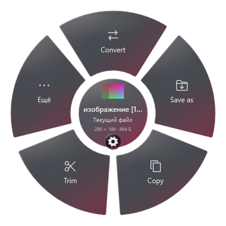
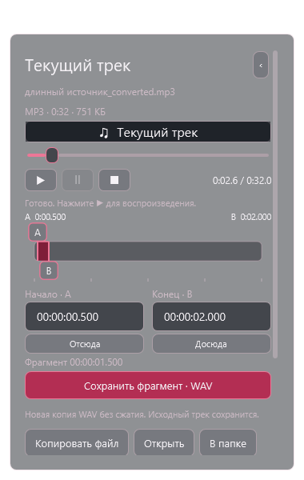
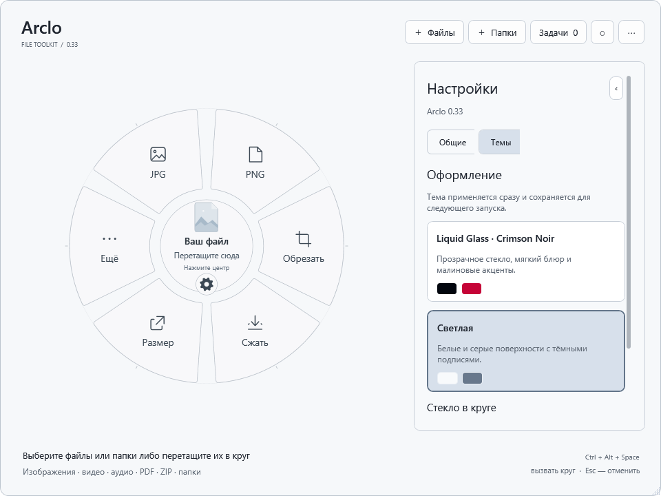

  

<strong>Работа с файлами — на расстоянии одной горячей клавиши.</strong>

Набор инструментов Windows с круговым меню у курсора.

  <a href="https://github.com/baronesses/Arclo/releases">Скачать</a> ·
  <a href="README.md">English</a> ·
  <a href="FUNCTIONALITY-RU.md">Руководство</a> ·
  <a href="https://github.com/baronesses/Arclo/issues/new/choose">Обратная связь</a>

Выделите файл в Проводнике, нажмите **Ctrl + Alt + Space** и выберите действие. Сохраните фотографию в PNG или JPG, извлеките звук из видео, обрежьте трек, распакуйте архив или превратите страницы PDF в картинки.

Круг подстраивается под выделение. Предпросмотр, параметры, прогресс и результат остаются рядом с текущим файлом. Для пакетной работы есть полное окно.

**Windows 10/11 x64 · Локальная обработка · Светлая тема и Liquid Glass**

## Как это выглядит

<table>
  <tr>
    <td width="50%"> <strong>Одно рабочее место для файлов</strong></td>
    <td width="50%"> <strong>Небольшое меню у курсора</strong></td>
  </tr>
  <tr>
    <td> <strong>Видно, какой фрагмент сохранится</strong></td>
    <td> <strong>Стекло или светлая тема на выбор</strong></td>
  </tr>
</table>

## Что умеет приложение

| Тип файлов | Инструменты |
| --- | --- |
| **Изображения** | Сохранение в JPG, PNG, BMP, TIFF, GIF и ICO; экспорт SVG со встроенным изображением. WebP и AVIF тоже доступны. Сжатие, размер, обрезка, поворот, отражение, текстовые и графические водяные знаки, очистка метаданных, контактный лист и PDF из изображений. |
| **Видео** | MP4 и WebM, размер и сжатие, удаление звука, извлечение аудио, кадры PNG, GIF и обрезка по времени. |
| **Аудио** | MP3, WAV, FLAC, M4A/AAC, Opus и Ogg/Vorbis; обрезка, громкость и плавные переходы, нормализация, теги и извлечение обложки. |
| **PDF и OCR** | Страницы в PNG/JPG; объединение, выбор и порядок страниц, поворот и разделение; извлечение текста и картинок, оптимизация PDF, распознавание русского и английского текста. |
| **Архивы и папки** | Создание ZIP, TAR, TAR.GZ и 7z; просмотр, полная и выборочная распаковка; 7z с паролем. |
| **Файловые операции** | Создание и сверка SHA-256, сведения о файлах и медиапотоках, пакетное переименование с предпросмотром и отменой. |
| **Ссылки** | Скачивание видео или трека в MP4/MP3, затем преобразование или обрезка. Вставка ссылки либо чтение адресной строки браузера. |

## Что делает работу удобнее

- **Круг там, где нужен.** Выделяйте файлы и папки в Проводнике или на рабочем столе и вызывайте меню своим сочетанием клавиш.
- **Вставка и работа в одном месте.** Ctrl + V загружает скопированный файл или ссылку. Convert, Save as, Copy, Trim и «Ещё» оставляют файл в центре.
- **Наглядная обрезка.** Перетаскивайте границы A/B или вводите точное время. Прослушайте фрагмент перед сохранением.
- **Управляемая очередь.** Следите за прогрессом, ставьте следующие задачи на паузу, продолжайте или отменяйте. Команды доступны и в трее.
- **Повторное использование настроек.** Сохраняйте пресеты, закрепляйте избранное, повторяйте обработку или собирайте цепочку инструментов для изображений.
- **Результаты под рукой.** Открывайте файл, показывайте его в папке, копируйте файл или путь, сравнивайте изображение с оригиналом.
- **Оформление на выбор.** Стекло Crimson Noir или светлая тема, размер круга, уменьшение прозрачности и порядок секторов.

## Начало работы

1. Запустите **Arclo.exe**. Установка и отдельная среда .NET не нужны.
2. Выделите файл в Проводнике и нажмите **Ctrl + Alt + Space**. Можно выбрать файлы в самом приложении или перетащить их в круг.
3. Нажмите действие. Ссылки на дополнительные компоненты обработки доступны внутри приложения, когда они нужны.
4. Новый файл появится рядом с оригиналом либо в выбранной папке вывода.

| Клавиши | Действие |
| --- | --- |
| Ctrl + Alt + Space | Показать или скрыть круг; сочетание меняется в настройках |
| Ctrl + O / Ctrl + Shift + O | Выбрать файлы / папки |
| Ctrl + V | Загрузить скопированный файл или ссылку |
| Ctrl + K | Найти инструмент |
| Esc / правая кнопка | Закрыть карточку или скрыть компактное меню |
| Влево / вправо, Enter | Выбрать и запустить действие в круге |

Настройки, история, пресеты и встроенные компоненты хранятся в **`%LOCALAPPDATA%\Arclo`**.

## Обратная связь

[Сообщите об ошибке или предложите функцию](https://github.com/baronesses/Arclo/issues/new/choose). Укажите версию приложения и что вы пытались сделать; небольшой пример или скриншот поможет разобраться.
