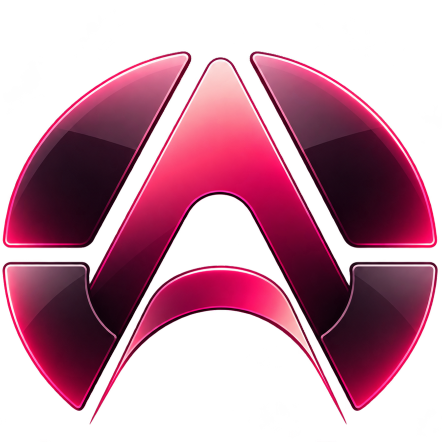

# Arclo identity and interface

## Brand assets

- [Logo, PNG](assets/arclo-logo.png) — the glossy crimson emblem.
- [Wordmark, SVG](assets/arclo-wordmark.svg) — the custom lettering for the name.
- [Repository banner, SVG](assets/arclo-banner.svg).

The app uses the simple text label **Arclo**. The supplied emblem and custom wordmark remain available here as brand assets.

## Themes

- **Liquid Glass / Crimson Noir:** dark glass, pearl lettering, and crimson accents.
- **Light:** pale surfaces and dark text.

The compact circle adapts its actions to the selected file. Tool cards, progress, and results stay nearby. Circle size, transparency, and sector order can be adjusted in settings.

The [README](../README.md) shows the full window, compact circle, trim timeline, and light theme.
